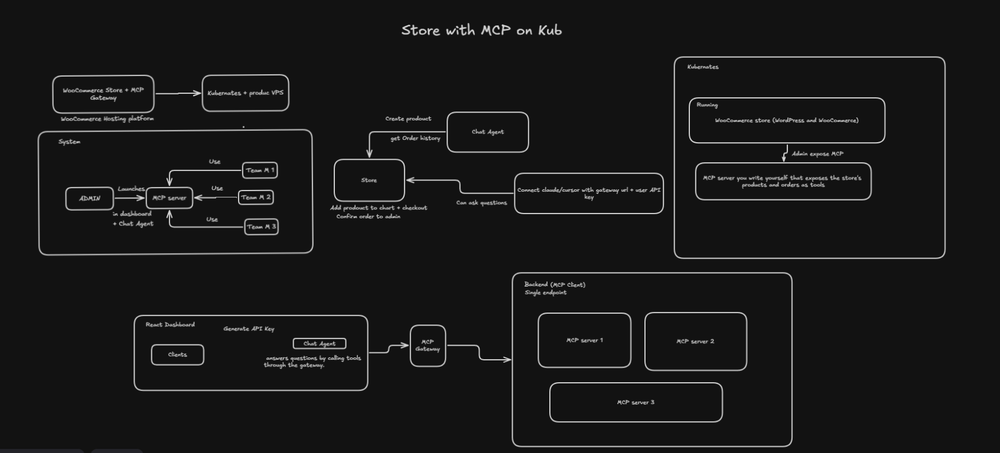
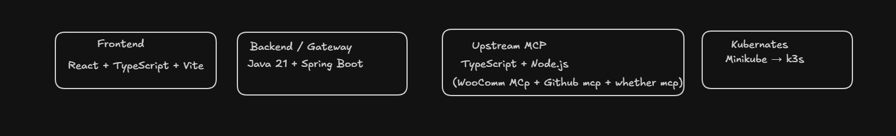
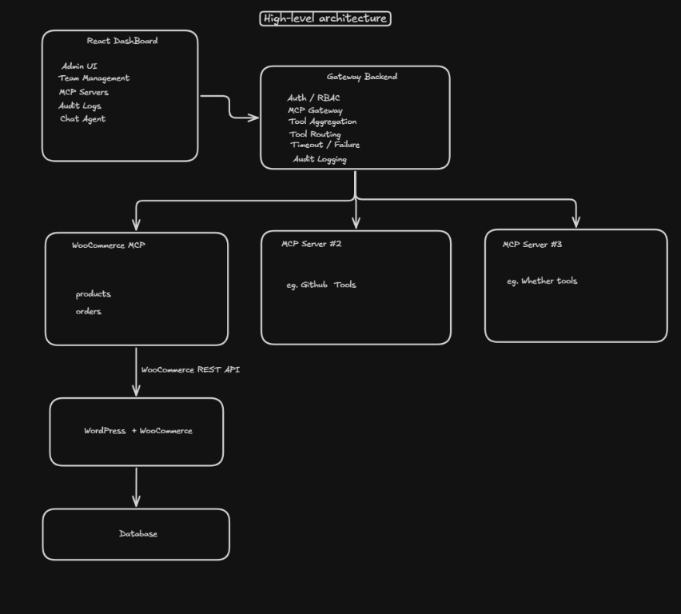
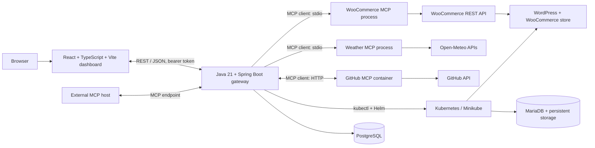
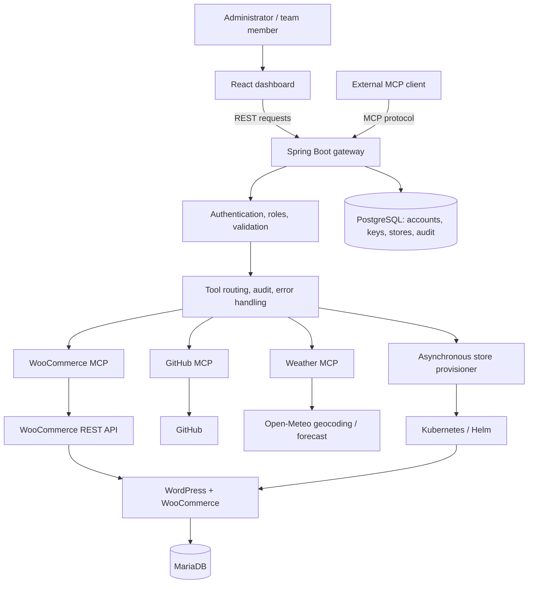
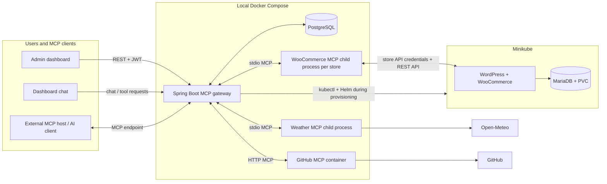

# MCP Gateway K8s Store

## Architecture images

### Store with MCP on Kubernetes



### Platform components



### High-level architecture



MCP Gateway K8s Store is a local-first control plane for connecting a React dashboard and AI/MCP clients to ecommerce, GitHub, and weather tools. Its Spring Boot backend provides a secured REST API and an MCP endpoint, manages the outbound MCP connections, persists users and operational data in PostgreSQL, and provisions additional WooCommerce stores into Kubernetes.

The project is composed of four cooperating areas:

1. **Dashboard** — React, TypeScript, and Vite user interface.
2. **Backend / gateway** — Java 21 and Spring Boot REST API, MCP client and server, authentication, audit, chat, and Kubernetes store lifecycle management.
3. **MCP integrations** — WooCommerce and Weather MCP server programs owned by this repository, plus the GitHub MCP server container used by the local Compose stack.
4. **Kubernetes store workloads** — Minikube hosts isolated WordPress/WooCommerce and MariaDB deployments for managed stores.

> **Important deployment detail:** Managed WordPress/WooCommerce and MariaDB workloads run in Kubernetes. The per-store WooCommerce MCP server is a Node.js child process started and supervised by the backend, not a pod in the store namespace. The project also runs the GitHub MCP server as a separate Docker Compose service. See the diagrams and [Architecture details](#architecture-details).

## Contents

- [Features](#features)
- [Architecture diagrams](#architecture-diagrams)
- [Architecture details](#architecture-details)
- [Repository layout](#repository-layout)
- [Prerequisites](#prerequisites)
- [Configuration and secrets](#configuration-and-secrets)
- [Run the complete local stack](#run-the-complete-local-stack)
- [Run the dashboard](#run-the-dashboard)
- [Run backend and MCP components separately](#run-backend-and-mcp-components-separately)
- [Kubernetes and managed stores](#kubernetes-and-managed-stores)
- [Service and port reference](#service-and-port-reference)
- [API and tool overview](#api-and-tool-overview)
- [Build, test, and lint](#build-test-and-lint)
- [Troubleshooting](#troubleshooting)
- [Project documentation](#project-documentation)

## Features

- Login with signed bearer tokens, role-based access control, and API-key authentication.
- Team membership and invitations, including optional SMTP delivery.
- Dashboard pages for overview, chat, WooCommerce, GitHub, weather, team, API keys, managed stores, and audit history.
- WooCommerce product, order, and customer operations through MCP tools.
- GitHub MCP-backed repository, code, issue, commit, pull-request, file, and user operations.
- Weather MCP-backed location lookup, current conditions, and forecast tools.
- A Spring AI chat integration configured with Google Gemini.
- A backend MCP server endpoint for external MCP clients, in addition to the backend's outbound MCP client connections.
- PostgreSQL persistence, database migrations, health endpoints, and audited operations.
- Asynchronous managed-store creation, recovery, retry, and deletion.
- Isolated namespaces and Helm releases for additional WooCommerce stores, with WordPress, MariaDB, persistent volumes, secrets, quotas, and resource limits.
- Store-specific MCP client processes and routing, so a WooCommerce request can target the selected managed store.

The first store is the pre-existing `ecommerce` namespace and is protected from deletion. The current implementation allows at most three stores total: the existing first store plus two managed stores (`ecommerce-store-2` and `ecommerce-store-3`).

## Architecture diagrams

### 1. Platform components

This view corresponds to the technology boundaries: browser UI, Spring gateway, upstream MCP integrations, and the local Kubernetes cluster.



### 2. Gateway and upstream tool architecture

The dashboard uses the gateway's application APIs; it does not connect to Kubernetes or MCP servers directly. The gateway authenticates and routes requests to an MCP integration. WooCommerce tools call the selected store's WooCommerce REST API.



### 3. Store + MCP operating model

This view combines the dashboard/chat-to-gateway usage with the store deployment. The store workload is in Minikube; the gateway starts a separate, store-configured MCP process and routes tool calls through it. This describes the repository's implementation (not an MCP pod deployed into each store namespace).



## Architecture details

### MCP roles

MCP clients initiate connections, discover tools, and call them; MCP servers advertise and execute tools. One application can have different roles on different connections.

| Component | Role | Connection |
|---|---|---|
| React dashboard | REST client; not an MCP client | HTTP/JSON to Spring Boot |
| Spring Boot backend | REST API server, outbound MCP client, and inbound MCP server | REST from the dashboard; MCP client connections to integrations; MCP endpoint for external clients |
| `mcp-servers/woocommerce` | MCP server | Stdio child process launched by Spring Boot |
| `mcp-servers/weather` | MCP server | Stdio child process launched by Spring Boot |
| `github-mcp` Compose service | MCP server | Streamable HTTP connection from Spring Boot |
| WordPress/WooCommerce | Ecommerce application and REST API | Called by the WooCommerce MCP server |
| MariaDB | Database | Used by WordPress/WooCommerce |

The backend's in-memory registry owns the live MCP sessions. For a managed store, Spring starts the shared WooCommerce server program with that store's URL and credentials, then routes requests using the persisted store ID. The MCP process is not deployed into Kubernetes.

### Request and store lifecycle

1. The dashboard authenticates with Spring Boot and sends feature requests to `/api/...`.
2. The backend applies authentication and authorization, invokes the relevant MCP tool, and returns a REST response. External MCP clients can instead connect to the backend MCP endpoint.
3. For store creation, the backend records a `PROVISIONING` store and schedules asynchronous work after the database transaction commits.
4. A controlled Kubernetes adapter creates an owned namespace and Kubernetes secrets, installs the Helm chart, waits for workloads, and checks the store endpoint.
5. The backend establishes a port forward, ensures WooCommerce API credentials, starts a store-specific MCP child process, and verifies the tool connection.
6. The store becomes `READY` only after validation. Failure details and lifecycle state are retained for retry and recovery.
7. Deletion closes the MCP process, verifies namespace ownership, uninstalls the Helm release, removes Kubernetes resources, and then removes the database row. Store 1 cannot be deleted.

Provisioning and deletion are asynchronous: the API may initially return `PROVISIONING` or `DELETING`; refresh the store list to see the updated state.

### Data persistence and recovery

PostgreSQL stores durable application records such as users, API keys, invitations, store metadata, and audit events. Flyway manages schema migrations. Store workloads persist WordPress data in Kubernetes persistent volume claims; each provisioned store has its own namespace, database, credentials, and data. Live MCP sessions and child processes are runtime state and are rebuilt by backend startup reconciliation after a restart.

## Repository layout

| Path | Purpose |
|---|---|
| `.env.example` | Root Docker Compose environment template; copy it to the ignored `.env` file and replace secret placeholders. |
| `.docker/` | Local Docker/Kubernetes integration data. The Docker-facing kubeconfig is generated here and is ignored by Git. |
| `.github/modernize/` | Repository modernization workflow artifacts/configuration. |
| `.run/` | IDE run configuration for the backend. |
| `backend/` | Spring Boot gateway, Maven wrapper, Dockerfile, Compose stack, configuration, migrations, and Java source. |
| `backend/src/main/java/.../config/` | Spring, AI, CORS, MCP, account bootstrap, and application configuration. |
| `backend/src/main/java/.../controller/` | REST API controllers, including authentication, ecommerce, GitHub, weather, chat, keys, audit, team, and store lifecycle APIs. |
| `backend/src/main/java/.../dto/` | Request and response data-transfer objects. |
| `backend/src/main/java/.../exception/` | API and application exception handling. |
| `backend/src/main/java/.../model/` | Persistence entities and domain models. |
| `backend/src/main/java/.../repository/` | Spring Data persistence interfaces. |
| `backend/src/main/java/.../security/` | JWT/API-key authentication and authorization components. |
| `backend/src/main/java/.../service/` | MCP integration clients, chat, auditing, security support, store provisioning, Kubernetes adapter, and recovery workflows. |
| `backend/src/main/resources/` | Spring configuration and Flyway database migrations. |
| `dashboard/` | React + TypeScript + Vite application, API client, pages/panels, styles, and frontend build configuration. |
| `docs/` | Detailed architecture, store creation flow, and restart-recovery documentation. |
| `helm/store-template/` | Helm chart for each managed WordPress/WooCommerce and MariaDB store. |
| `mcp-servers/woocommerce/` | WooCommerce MCP server source, TypeScript build configuration, and its local environment file. |
| `mcp-servers/weather/` | Weather MCP server source and TypeScript build configuration. |
| `mcp-servers/github/` | Repository-local GitHub MCP-related source/package files. The current Compose topology uses the official GitHub MCP server image instead of building this directory. |
| `scripts/Prepare-DockerKubeconfig.ps1` | Refreshes the Minikube context and creates a kubeconfig that the backend container can use. |
| `scripts/Start-DockerCompose.ps1` | Checks tools/context, starts Minikube if needed, prepares kubeconfig, and starts the Compose stack. |
| `scripts/Test-StoreLifecycle.ps1` | Exercises managed-store lifecycle and recovery scenarios against a running local stack. |
| `scripts/Repair-StoreDatabaseProbes.ps1` | Repairs MariaDB workload probes for a specifically identified, ownership-verified managed store. |
| `wordpress-values.yaml` | Root-level WordPress deployment values configuration. |

Generated build output such as `dashboard/dist`, MCP `dist` folders, Maven `target`, `node_modules`, and `.docker/kubeconfig` is not source and should not be committed.

## Prerequisites

For the recommended local Docker Compose workflow:

- Windows 10/11 with PowerShell.
- Git.
- Docker Desktop with Docker Compose v2, running and able to build containers.
- Minikube, `kubectl`, and a working Minikube Docker network/profile.
- GitHub Personal Access Token and Google Gemini API key for the integrations enabled in this Compose configuration.
- An existing WooCommerce store deployed at the expected Minikube namespace/release and valid WooCommerce REST API credentials. The default store is `ecommerce` / `ecommerce-store`; additional stores are provisioned by the backend.

For native development or independent MCP server runs, also install:

- Java 21 JDK (the Maven wrapper is included).
- Node.js 22 and npm.
- Helm if installing or inspecting the chart directly on the host. The backend container includes `kubectl` and Helm for its provisioning workflow.

Allocate sufficient CPU, memory, and storage to Docker Desktop and Minikube for PostgreSQL, the backend, and the Kubernetes store workloads. The chart defines per-store resource requests, limits, quotas, and persistent volumes.

## Configuration and secrets

### Root Compose environment

Create the root `.env` file from the template:

```powershell
Copy-Item .env.example .env
```

Edit `.env` and replace the placeholders. The recommended Compose stack requires:

| Variable | Purpose |
|---|---|
| `GOOGLE_API_KEY` | Google Gemini access used by the chat integration. |
| `GITHUB_PERSONAL_ACCESS_TOKEN` | GitHub MCP authentication. The Compose GitHub server is configured in read-only mode. |
| `POSTGRES_DB`, `POSTGRES_USER`, `POSTGRES_PASSWORD` | Local PostgreSQL database configuration. |
| `JWT_SECRET` | Signing key for application bearer tokens; replace the template value with a strong random secret. |
| `INITIAL_ADMIN_USERNAME`, `INITIAL_ADMIN_PASSWORD` | Bootstrap administrator account. Set a unique password. |
| `INITIAL_MEMBER_USERNAME`, `INITIAL_MEMBER_PASSWORD` | Optional initial member account; set both or leave both empty. |
| `DASHBOARD_ALLOWED_ORIGIN` | Browser origin allowed by the backend, normally `http://localhost:5173`. |
| `KUBERNETES_CONTEXT` | Minikube context name, normally `minikube`. |
| `MINIKUBE_BACKEND_IP` | Backend container address on the Minikube Docker network; it must not collide with a Minikube network address. |
| `GEMINI_CHAT_MODEL`, `GEMINI_FALLBACK_MODEL` | Chat model names. |
| `TEAM_INVITATION_*`, `SPRING_MAIL_*` | Invitation expiry, frontend URL, and optional email delivery settings. |
| `STORES_WOOCOMMERCE_PLUGIN_VERSION` | WooCommerce plugin version installed for managed stores. |

Other values in `.env.example` have local-development defaults. Review them for your environment before starting the stack. Do not commit `.env` or live credentials.

### WooCommerce MCP credentials

The Compose backend also loads `mcp-servers/woocommerce/.env`. Create that file and configure credentials for the existing first store:

```dotenv
WOOCOMMERCE_URL=http://127.0.0.1:38081
WOOCOMMERCE_CONSUMER_KEY=replace_with_store_consumer_key
WOOCOMMERCE_CONSUMER_SECRET=replace_with_store_consumer_secret
```

`WOOCOMMERCE_URL` must be reachable from the backend container. In the Compose configuration the backend uses `http://127.0.0.1:38081` for the default store port forward. The key and secret must be valid WooCommerce REST API credentials with the permissions required by the tools. For local HTTP URLs, the WooCommerce MCP client uses OAuth 1.0a signing; HTTPS URLs use Basic authentication.

The `.env` files are local secrets and must not be checked in. The `.gitignore` excludes local env files and the generated `.docker/kubeconfig`.

## Run the complete local stack

The recommended startup path is Windows PowerShell and the repository helper script. It brings up the backend, PostgreSQL, and GitHub MCP service, while ensuring the backend can reach Minikube.

### 1. Start Docker Desktop and select Minikube

Make sure Docker Desktop is running. Then start Minikube and make its context active:

```powershell
minikube start -p minikube
kubectl config use-context minikube
kubectl config current-context
minikube status -p minikube
```

The current context must print `minikube`. The helper intentionally stops rather than changing to a different Kubernetes context without your consent.

### 2. Configure the environment

Create and edit the root `.env` as described above. Create `mcp-servers/woocommerce/.env` with the existing store URL and API credentials. Confirm that the `ecommerce` namespace and `ecommerce-store` Helm release are available and that the default store is healthy.

### 3. Build and start Compose

On the first start, build the backend image. The script starts Minikube if it is stopped, refreshes a Docker-facing kubeconfig with the stable in-network Minikube endpoint, and starts the services:

```powershell
.\scripts\Start-DockerCompose.ps1 -Build
```

To start again without rebuilding:

```powershell
.\scripts\Start-DockerCompose.ps1
```

Useful script options:

```powershell
.\scripts\Start-DockerCompose.ps1 -Build -ForceRecreate
.\scripts\Start-DockerCompose.ps1 -NoDeps backend
```

The backend image compiles the WooCommerce and Weather MCP TypeScript projects and packages them with the Spring Boot application. The backend starts those MCP programs as child processes. Compose separately starts the official GitHub MCP container and PostgreSQL.

Equivalent Compose commands (after the Minikube network and `.docker/kubeconfig` are ready) can be run from the repository root:

```powershell
docker compose --env-file .env -f backend/compose.yaml up --detach --build
docker compose --env-file .env -f backend/compose.yaml ps
docker compose --env-file .env -f backend/compose.yaml logs --follow backend db github-mcp
```

The dashboard is not part of this Compose file; run it separately as described in [Run the dashboard](#run-the-dashboard).

### 4. Verify the backend

```powershell
Invoke-RestMethod http://localhost:8081/actuator/health
docker compose --env-file .env -f backend/compose.yaml ps
```

Open the dashboard at `http://localhost:5173` after starting Vite. Sign in using the bootstrap administrator username and password configured in `.env`. Change the example credentials before using this stack beyond a throwaway local environment.

### 5. Stop the stack

```powershell
docker compose --env-file .env -f backend/compose.yaml down
```

This stops the containers but preserves the named PostgreSQL volume and Kubernetes store workloads. Avoid `down --volumes` unless you intentionally want to delete the local PostgreSQL data. Managed Kubernetes stores must be deleted through the application lifecycle or an explicitly reviewed Kubernetes cleanup—not by deleting their database rows.

## Run the dashboard

The frontend can be developed independently while the backend stack is running:

```powershell
Set-Location dashboard
npm ci
$env:VITE_API_BASE_URL = "http://localhost:8081"
npm run dev
```

Vite prints the dashboard URL (normally `http://localhost:5173`). Keep the API base URL aligned with the backend and the `DASHBOARD_ALLOWED_ORIGIN` CORS setting. To create a production build:

```powershell
npm run build
npm run preview
```

## Run backend and MCP components separately

The full Compose path is the simplest way to ensure the backend, database, GitHub MCP service, MCP child processes, and Minikube networking agree. The following notes are useful for development and diagnosis.

### Backend

The Spring Boot project is in `backend/` and includes the Maven wrapper. Build or test it with:

```powershell
Set-Location backend
.\mvnw.cmd test
.\mvnw.cmd spring-boot:run
```

For a native backend run, start PostgreSQL and the GitHub MCP HTTP service first, configure the datasource, JWT, AI, GitHub, WooCommerce, and Kubernetes environment expected by `backend/src/main/resources/application.properties` and `application.yml`, and ensure Node.js is on `PATH`. The backend starts the WooCommerce and Weather MCP server programs itself; do not start duplicate copies for the same backend session. Use Compose for a ready-to-run configuration of those dependencies.

The backend listens on port `8081`. Health endpoints include `/actuator/health` and `/api/health`.

### WooCommerce MCP server

This server is an MCP stdio program. In normal operation the backend launches it, supplies the selected store's URL and credentials, initializes the MCP session, discovers tools, and checks connectivity. To build or run it independently for development:

```powershell
Set-Location mcp-servers/woocommerce
npm ci
npm run build
npm start
```

Set `WOOCOMMERCE_URL`, `WOOCOMMERCE_CONSUMER_KEY`, and `WOOCOMMERCE_CONSUMER_SECRET` in the process environment or the server's local `.env` file before running. Since it communicates over standard input/output using MCP, it is not a standalone HTTP service; a client (normally Spring Boot) must start and speak the protocol.

Tools: `list_products`, `get_product`, `list_orders`, `get_order`, `list_customers`, `get_customer`, `create_product`, and `update_order_status`.

### Weather MCP server

This is also an MCP stdio program, normally started automatically by Spring Boot:

```powershell
Set-Location mcp-servers/weather
npm ci
npm run build
npm start
```

It calls Open-Meteo APIs and provides `search_location`, `get_current_weather`, and `get_weather_forecast`. An internet connection is needed for geocoding and forecast requests.

### GitHub MCP server

The local Compose deployment uses the official `ghcr.io/github/github-mcp-server:latest` container in HTTP mode. It is started with the Compose stack, exposed on host loopback port `8082`, and configured read-only. Spring Boot connects to it at `http://github-mcp:8082/mcp` from the Compose network.

`mcp-servers/github/` is present in the repository, but it is not the GitHub server built or run by `backend/compose.yaml`; do not assume it has the same launch/build lifecycle as the project-owned WooCommerce and Weather MCP servers.

## Kubernetes and managed stores

### Minikube networking

The backend container talks to Minikube through the external Docker network named after the Kubernetes context. Minikube's host-published API port can change after a restart, so `scripts/Prepare-DockerKubeconfig.ps1` refreshes the host context and writes `.docker/kubeconfig` with the stable Docker-network API endpoint. `Start-DockerCompose.ps1` runs this preparation automatically before starting Compose.

To refresh only the Docker-facing kubeconfig:

```powershell
.\scripts\Prepare-DockerKubeconfig.ps1 -Context minikube
```

For basic cluster inspection:

```powershell
kubectl config current-context
kubectl get nodes
kubectl get namespaces
kubectl get pods --all-namespaces
minikube status -p minikube
```

### Store provisioning

After the backend and cluster are healthy, sign in as an administrator and use the **Managed Stores** dashboard. Creating a store provisions a namespace and Helm release, waits for Kubernetes resources and WordPress to become ready, configures its WooCommerce API credentials, starts a backend-managed MCP process, and validates it before marking the store `READY`.

Managed stores use separate namespaces (`ecommerce-store-2` and `ecommerce-store-3`), Helm releases, WordPress and MariaDB workloads, credentials, and persistent volumes. The Helm chart is in `helm/store-template`. Lifecycle state and errors are visible from the dashboard. Provisioning and deletion can take time; refresh the store list rather than resubmitting a create request while a store is in progress.

The backend verifies ownership before deleting resources. The first `ecommerce` store is intentionally protected. If Kubernetes connectivity is not available, store creation should fail before saving an orphaned provisioning record; restore cluster connectivity and retry from the dashboard.

### Store lifecycle verification script

With the Compose stack running, the PowerShell lifecycle helper can exercise recovery and store operations. It can create test stores, write a temporary test product, restart the backend (and optionally the Minikube engine), verify recovery, and delete only the test stores it created. Review its parameters and expected cluster impact before using:

```powershell
.\scripts\Test-StoreLifecycle.ps1
```

Optional parameters are `-IncludeClusterRestart`, `-ResumeVerificationStoreId <id>`, and `-VerifyRecreatedStoreId <id>`. The script requires an available store slot for a new run, and may restart backend/Minikube containers and create/delete verification stores. Use it only against a disposable development environment.

## Service and port reference

| Service | Local address / port | Notes |
|---|---|---|
| Dashboard (Vite dev server) | `http://localhost:5173` | Started separately with `npm run dev`. |
| Spring Boot backend | `http://localhost:8081` | REST API, chat, and backend MCP endpoint. |
| Backend health | `http://localhost:8081/actuator/health` | Spring Boot Actuator health check. |
| GitHub MCP host mapping | `127.0.0.1:8082` | GitHub container; read-only local Compose configuration. |
| PostgreSQL | `localhost:5432` | Compose database; persisted in a named Docker volume. |
| Default store port forward | `38081` | Existing `ecommerce` store, available to the backend container. |
| Managed store port forwards | `38082`, `38083` | Additional stores; bound to host loopback by Compose. |
| WooCommerce / Weather MCP | No host HTTP port | Backend-managed stdio child processes. |
| Kubernetes API | Minikube Docker network | Backend uses generated `.docker/kubeconfig`, not a fixed host API port. |

## API and tool overview

API routes are authenticated unless explicitly intended for health or login. Authorization policies also distinguish administrator-only operations.

| Route group | Responsibility |
|---|---|
| `/api/auth` | Login, current profile, invitation acceptance. |
| `/api/woocommerce` | WooCommerce status and product, order, and customer operations; `storeId` selects a managed-store MCP client. |
| `/api/stores` | List, create, retry, delete, and inspect store lifecycle state. |
| `/api/github` | GitHub MCP status, tool listing, and supported GitHub operations. |
| `/api/weather` | Weather MCP status, location search, current weather, and forecast. |
| `/api/team` | Team members and invitations. |
| `/api/keys` | API-key creation, listing, and revocation. |
| `/api/audit` | Paginated audit events. |
| `/api/health`, `/actuator/health` | Application health checks. |
| `/mcp` | Backend MCP server endpoint for external MCP hosts. |

The backend also exposes curated tools from its MCP server configuration to external MCP clients. Tool authorization is enforced by the backend; the dashboard's REST API and external MCP endpoint are separate access paths.

## Build, test, and lint

Run focused checks from each project:

```powershell
# Backend
Set-Location backend
.\mvnw.cmd test

# Dashboard
Set-Location ..\dashboard
npm ci
npm run lint
npm run build

# WooCommerce MCP
Set-Location ..\mcp-servers\woocommerce
npm ci
npm run typecheck
npm run build

# Weather MCP
Set-Location ..\weather
npm ci
npm run typecheck
npm run build
```

The GitHub service in the local runtime is an upstream container image. Its local repository directory does not provide the same `build` and `start` scripts as the WooCommerce and Weather MCP packages.

## Troubleshooting

### The Compose startup script reports the wrong Kubernetes context

Check `kubectl config current-context`, then explicitly select Minikube:

```powershell
kubectl config use-context minikube
minikube status -p minikube
```

Run `.\scripts\Start-DockerCompose.ps1` again after the context is correct.

### The backend cannot connect to Minikube

Confirm Minikube is running and Docker is using the same Minikube profile. Refresh the Docker-facing kubeconfig with `.\scripts\Prepare-DockerKubeconfig.ps1 -Context minikube`, then restart the backend service. The Compose stack expects the `minikube` Docker network and the generated `.docker/kubeconfig`.

### Required GitHub or Google key is missing

Check that the root `.env` exists and contains non-placeholder `GITHUB_PERSONAL_ACCESS_TOKEN` and `GOOGLE_API_KEY` values. The Compose file requires both values. Do not print or paste secrets into logs or issue reports.

### WooCommerce MCP initialization fails

Check the existing `ecommerce` namespace/release, the service's health, the default store port-forward on `38081`, and the credentials in `mcp-servers/woocommerce/.env`. Verify that the WooCommerce REST API keys can access the expected products endpoint.

### Store remains `PROVISIONING`, `RECOVERING`, or `FAILED`

Inspect backend logs and the dashboard's store error/status, then check namespace pods and events:

```powershell
kubectl get pods -n ecommerce-store-2
kubectl get events -n ecommerce-store-2 --sort-by=.lastTimestamp
docker compose --env-file .env -f backend/compose.yaml logs --follow backend
```

Use the actual store namespace (`ecommerce-store-2` or `ecommerce-store-3`). Fix the underlying cluster, chart, image-pull, storage, or credential issue before retrying. Do not delete a lifecycle database row to try to clean up Kubernetes resources.

### Dashboard requests fail due to CORS or backend URL

Verify the backend is listening on `8081`, set `VITE_API_BASE_URL` to `http://localhost:8081`, and set `DASHBOARD_ALLOWED_ORIGIN=http://localhost:5173` in the root `.env`. Restart the backend after changing Compose environment values.

## Project documentation

- [Architecture overview](docs/architecture.md)
- [Store creation and MCP flow](docs/store-creation-flow.md)
- Restart recovery behavior is summarized in the [architecture overview](docs/architecture.md).
