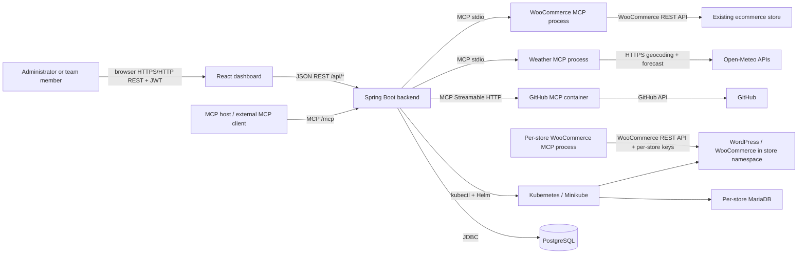
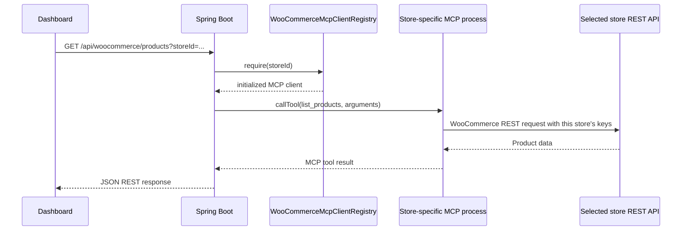

# MCP Gateway and Managed Store Architecture

This document describes the architecture implemented in this repository. It follows the code and local Docker/Kubernetes configuration; environment-specific URLs, credentials, and service availability can differ between deployments.

## 1. What the project is

The MCP Gateway is a web application and integration gateway. It provides:

- A React dashboard for administrators and team members.
- A Spring Boot REST API for the dashboard, authentication, business operations, and managed-store lifecycle.
- Outbound MCP clients in Spring Boot that connect to WooCommerce, GitHub, and Weather MCP servers.
- An inbound MCP server endpoint exposed by Spring Boot for external MCP hosts.
- An asynchronous store provisioner that creates isolated WordPress/WooCommerce and MariaDB deployments in Kubernetes.
- PostgreSQL persistence for users, API keys, invitations, audit records, and managed-store records.

MCP means Model Context Protocol. In this project it is the protocol used to discover tools and send typed tool calls between a client and a server. It does not mean that every application or service in the system is an MCP server.

## 2. Architecture at a glance



The browser talks to Spring Boot using ordinary HTTP/JSON REST calls. The Spring application is the integration boundary: it validates the caller, selects the relevant integration, invokes MCP tools, applies role checks, maps errors, and records audit events.

## 3. The client/server roles

An MCP client initiates a protocol connection, discovers a server's tools, and calls them. An MCP server advertises tools and executes their handlers. A service can be a client for one connection and a server for another.

| Component | Role in this project | Connection / upstream |
|---|---|---|
| Dashboard (React in the browser) | REST client; **not** an MCP client | Calls Spring Boot `/api/...` with a bearer token |
| Spring Boot backend | REST API server; outbound MCP client; also inbound MCP server | Connects to the WooCommerce, Weather, and GitHub MCP servers; exposes its own `/mcp` tools |
| `mcp-servers/woocommerce` Node process | MCP server | Calls a WooCommerce REST API using URL and consumer credentials |
| `mcp-servers/weather` Node process | MCP server | Calls Open-Meteo geocoding and forecast APIs |
| `github-mcp` Compose service | MCP server (official GitHub MCP Server image) | Calls GitHub APIs using the configured token |
| WordPress/WooCommerce deployment in a store namespace | E-commerce application/API; **not** an MCP client or server | Serves the WooCommerce REST API used by that store's WooCommerce MCP process |
| MariaDB in a store namespace | Database; neither MCP client nor server | Persists WordPress data |
| External AI/automation host connected to backend `/mcp` | MCP client | Discovers and invokes tools exposed by `McpGatewayTools` |

### The two directions of MCP communication

1. **Backend as MCP client:** Spring Boot's MCP client configuration connects to the three integration MCP servers. For tools in one of those integrations, Java calls `listTools` and `callTool` on its `McpSyncClient`.
2. **Backend as MCP server:** Spring AI scans `McpGatewayTools` annotations and exposes the gateway tools on the backend MCP endpoint. A separate MCP host can connect to that endpoint. This does not make the browser an MCP client.

These roles are independent. In particular, “store is connected as an MCP client” is shorthand for the backend creating an MCP client connection for that store. The store deployment itself is not the client.

## 4. Dashboard to Spring Boot communication

The dashboard is a Vite/React TypeScript application. `dashboard/src/api.ts` creates an Axios client with a base URL from `VITE_API_BASE_URL`, defaulting to `http://localhost:8081`, and a 30-second request timeout. API helper groups such as `commerceApi`, `storesApi`, `githubApi`, `weatherApi`, `teamApi`, `apiKeysApi`, and `auditApi` wrap backend REST endpoints. Authenticated calls send `Authorization: Bearer <accessToken>`.

`dashboard/src/App.tsx` owns login/session and page state, loads status and data, and chooses which feature panel to render. The panels include the overview, WooCommerce, GitHub, Weather, managed stores, team, API keys, and audit log. `ManagedStoresPanel.tsx` calls the store API, displays the store status and any error, and provides create, retry, delete, and refresh actions. The dashboard does not call Kubernetes, Helm, WooCommerce REST, or MCP servers directly.

On login, the browser posts credentials to `/api/auth/login`. Spring Boot authenticates the account and returns a signed access token and profile. Subsequent API calls are stateless; Spring Security validates the bearer token and reloads the account and role. API keys are also supported by a dedicated authentication filter. CORS is configured for the dashboard origin using `DASHBOARD_ALLOWED_ORIGIN`.

Store endpoints are under `/api/stores` and require `ADMIN`. Team administration is also admin-only. Other endpoints require authentication, with additional admin restrictions for write operations such as creating products or changing order status. The dashboard renders an error message from the API response or a safe fallback; status and error details are also persisted for managed-store lifecycle operations.

### Main REST endpoint groups

| Route group | Responsibility |
|---|---|
| `/api/auth` | Login, current profile, invitation acceptance |
| `/api/woocommerce` | WooCommerce status/tools plus product, order, and customer operations; optional `storeId` routes an operation to a managed store |
| `/api/stores` | List, create, retry, delete, and inspect store lifecycle state |
| `/api/github` | GitHub MCP status, tools, repository/code search, issues, and supported tool invocation |
| `/api/weather` | Weather MCP status, tools, location lookup, current conditions, and forecast |
| `/api/team` | Team membership and invitations |
| `/api/keys` | Create, list, and revoke API keys |
| `/api/audit` | Paginated audit events, with user-specific access available for members |
| `/api/health`, `/actuator/health` | Health probes |

## 5. Spring Boot backend responsibilities

The Java application is under `backend/src/main/java/com/mcp_gateway_k8s_store/backend`.

- **Controllers** (`controller/`) define the REST boundary and translate HTTP requests to application-service calls.
- **Services** (`service/`) hold MCP integration logic, tool routing, authentication support, audit logic, and provisioning workflows.
- **Models and repositories** (`model/`, `repository/`) persist users, roles, store state, API keys, invitations, and audit data through Spring Data JPA.
- **DTOs** (`dto/`) define request and response shapes and keep persistence entities out of the REST contract.
- **Security/configuration** (`config/`, `security/`) configures stateless JWT authentication, API-key authentication, CORS, MCP clients, and the async provisioning executor.
- **Exception handling** maps application failures into HTTP error responses consumed by the dashboard.

`WooCommerceMcpService`, `GitHubMcpService`, and `WeatherMcpService` select an initialized MCP client, invoke the named tool, handle MCP errors, and map returned structured or textual content into Java values. `McpGatewayTools` exposes a curated set of corresponding gateway tools to inbound MCP clients and audits invocations. Some gateway tools require an admin role; REST routes additionally enforce their own policy.

The MCP client configuration is in `backend/src/main/resources/application.yml`: WooCommerce and Weather use stdio connections; GitHub uses a Streamable HTTP connection. `GitHubMcpHttpConfiguration` attaches the configured GitHub bearer token and read-only/toolset headers to the GitHub MCP connection. `application.properties` contains server, database, JWT, CORS, and Kubernetes/Helm settings.

## 6. MCP integrations and their TypeScript code

The TypeScript MCP servers are separate Node programs. Their source is in `mcp-servers/`; package manifests and TypeScript configurations define their dependencies, scripts, module format, and compiler output. The backend Docker build compiles WooCommerce and Weather and includes their runtime files. GitHub is supplied as a separate official container rather than compiled from this repository's `mcp-servers/github` directory.

### WooCommerce MCP server

The project-owned WooCommerce server is in `mcp-servers/woocommerce/src/`.

- `server.ts` creates an SDK `McpServer`, registers tool metadata and handlers, and connects a `StdioServerTransport`. Protocol messages use stdin/stdout; logs go to stderr.
- `config.ts` reads and validates the WooCommerce URL and consumer key/secret from the process environment.
- `woocommerce-client.ts` wraps WooCommerce REST API requests and authentication.
- `tools/` separates tool input schema and execution logic. Implemented tools are `list_products`, `get_product`, `list_orders`, `get_order`, `list_customers`, `get_customer`, `create_product`, and `update_order_status`.
- The read operations retrieve ecommerce records. `create_product` and `update_order_status` make mutations; the backend applies admin authorization before exposing corresponding write operations.

The same TypeScript server code is launched as an MCP subprocess for the existing WooCommerce integration and for each provisioned store. Each process gets its own environment. For a managed store, the environment contains that store's URL and its own WooCommerce API credentials; there is no shared client routing between stores.

### GitHub MCP server

The active GitHub server is the `github-mcp` service in `backend/compose.yaml`, using `ghcr.io/github/github-mcp-server:latest` in HTTP mode on container port 8082. The backend addresses it by Compose DNS name at `http://github-mcp:8082/mcp`; the host port is bound to loopback for local access. `GITHUB_PERSONAL_ACCESS_TOKEN` is supplied to Spring Boot, and the backend MCP client customizer adds the authorization header and read-only configuration. The Compose service also sets `GITHUB_READ_ONLY=1`.

“Where the GitHub MCP server is” therefore has two answers: in the running local topology, it is the separate `github-mcp` Docker container; in this repository, its service declaration and connection configuration are in `backend/compose.yaml`, `application.yml`, and `GitHubMcpHttpConfiguration.java`. `mcp-servers/github` contains repository-local TypeScript artifacts, but the Compose topology described above does not build or run those artifacts as the active GitHub MCP server.

`GitHubMcpService` identifies the GitHub client by its advertised GitHub tool names, validates tool names against an allowlist, and exposes read-oriented repository, code, issue, commit, pull-request, file, and user operations supported by the configured upstream server/toolset.

### Weather MCP server

The project-owned Weather server is in `mcp-servers/weather/src/server.ts`. It uses the MCP SDK and stdio. Its tools are `search_location`, `get_current_weather`, and `get_weather_forecast`. It geocodes a place with Open-Meteo, obtains current or daily forecast data, normalizes the response and weather codes, and returns JSON text as MCP content. `WeatherMcpService` invokes the corresponding tools and validates forecast length from one to seven days.

## 7. Managed-store architecture and creation flow

### Store objects and isolation

The first store is the pre-existing `ecommerce` namespace and is represented as Store 1 when it is not already persisted as a managed `Store` row. Store 1 is protected from deletion. Additional stores are limited to two and are assigned the namespaces/releases `ecommerce-store-2` and `ecommerce-store-3`. The database row contains the display name, namespace, Helm release, URL, status, error, and timestamps. The store ID is also attached as an ownership label to Kubernetes resources so deletion can verify ownership.

Each extra store has its own Kubernetes namespace, Helm release, WordPress/WooCommerce deployment, MariaDB deployment, PVCs, credentials, and WooCommerce MCP client process. Store IDs used for MCP routing are backend database IDs; namespaces and Helm releases are Kubernetes names. The mapping is maintained by `WooCommerceMcpClientRegistry` keyed by the database store ID.

### Creation sequence

```mermaid
sequenceDiagram
  actor Admin
  participant UI as React dashboard
  participant API as Spring Boot REST
  participant DB as PostgreSQL
  participant Worker as Async StoreProvisioningWorker
  participant K as KubernetesStoreAdapter
  participant Cluster as Kubernetes / Helm
  participant MCP as Per-store WooCommerce MCP process
  participant WP as Store WordPress/WooCommerce

  Admin->>UI: Enter store name and create
  UI->>API: POST /api/stores (bearer JWT)
  API->>API: Require ADMIN; enforce max-store and namespace rules
  API->>DB: Insert Store(PROVISIONING)
  API-->>UI: Return store ID and PROVISIONING
  API->>Worker: Schedule after DB transaction commits
  Worker->>K: Verify Kubernetes context and target ownership
  K->>Cluster: Create owned namespace and credential Secrets
  K->>Cluster: Helm upgrade --install with --wait
  Cluster-->>K: WordPress + MariaDB workloads ready
  K->>Cluster: Wait for store pods; verify WordPress service
  K->>WP: Port-forward and verify HTTP endpoint
  K->>WP: Ensure WooCommerce REST API keys exist
  Worker->>MCP: Start Node server with store URL and keys
  MCP->>WP: list_products health call
  MCP-->>Worker: Required tools + successful health result
  Worker->>DB: Save URL and READY
  UI->>API: Refresh/poll GET /api/stores
  API-->>UI: Return READY store
```

In more detail:

1. The admin submits a name to `POST /api/stores`. `StoreProvisioningController` receives it; `StoreProvisioningService` validates capacity and reserves the next free managed namespace. The existing first store counts toward the maximum of three.
2. A database row is saved as `PROVISIONING`. The worker is scheduled after the transaction commits so it cannot observe a row that later rolls back. The REST response means the request was accepted; provisioning continues asynchronously.
3. `StoreProvisioningWorker` generates random passwords and calls `KubernetesStoreAdapter`. The adapter checks the configured context, restricts operations to approved namespace/release names, creates an owned namespace and Kubernetes Secrets, and invokes Helm with a generated short-lived values file.
4. The chart in `helm/store-template` installs WordPress with WooCommerce and MariaDB, persistent storage, resource requests/limits, quota, and limit range. The adapter waits for Helm resources and pods to become Ready and checks that the WordPress service exists.
5. The adapter sets up a local host port-forward for the store and verifies the HTTP endpoint. It ensures WooCommerce REST API credentials exist and returns the consumer key/secret to the worker. Secrets are stored in Kubernetes; the values file is removed after Helm completes.
6. `WooCommerceMcpClientRegistry.register` launches the WooCommerce Node MCP server with that store's URL/key/secret. It initializes MCP, checks that all eight required tools exist, and makes a `list_products` call to verify that the WooCommerce REST API works.
7. Only after those checks does the worker set the database status to `READY` and expose the store URL. If any step throws, it stores `FAILED` and a sanitized error message. Correctly owned Kubernetes resources are retained for diagnosis and retry rather than silently removed.

The React UI should treat the returned `PROVISIONING` status as accepted/in progress. A later list/status refresh displays `READY` or `FAILED`; the API call is not a synchronous promise that all pods are already available.

### Per-store request routing

For WooCommerce REST routes, the dashboard may pass `storeId` as a query parameter. The controller delegates to the WooCommerce service, which uses that ID to fetch the corresponding initialized client from `WooCommerceMcpClientRegistry`. That client is connected only to the MCP process whose environment contains the selected store's credentials. The MCP process then calls the matching store's WooCommerce REST API.



Without `storeId`, the service selects the configured default WooCommerce MCP client by tool name. The browser does not supply WooCommerce API secrets.

### Lifecycle states, retry, and deletion

`StoreStatus` defines `PROVISIONING`, `READY`, `RECOVERING`, `FAILED`, and `DELETING`.

- **PROVISIONING:** asynchronous create or retry work is underway.
- **READY:** Kubernetes checks and the store-specific MCP/API health check succeeded.
- **RECOVERING:** an existing store is reconnecting automatically after a temporary outage.
- **FAILED:** creation/provisioning failed; the sanitized message is shown. Provisioning retry is permitted.
- **DELETING:** deletion has been accepted and cleanup is underway. On failure, the row remains `DELETING` with a “Deletion failed and can be retried” message; retry resumes cleanup.

Deleting Store 2 or Store 3 is also asynchronous. The backend refuses Store 1, validates the namespace/release pattern, closes the store MCP client, verifies the namespace ownership label, stops its port-forward, uninstalls the Helm release, waits for namespace deletion, and only then removes the database row. If cleanup fails, the database row is intentionally retained so the operation can be retried. Store deletion is not simply deleting the database record.

On Spring Boot startup, `StoreReconciliationRunner` revisits persisted `PROVISIONING` and `DELETING` stores and resumes their work. Previously ready stores enter `RECOVERING` while their runtime connections are rebuilt. A scheduled check continues checking `READY` and `RECOVERING` stores with bounded backoff, supervising port-forwards and repairing WooCommerce plugin availability before validating credentials and MCP/API connectivity. Temporary outages do not become permanent provisioning failures. See [restart recovery](restart-recovery.md) for networking, per-store storage identity, and verification details.

The async worker uses a bounded executor. Store operations run in a background thread so the HTTP request can return promptly. A new store's deployment readiness is established by Helm/pod waits plus the endpoint/MCP checks, not merely by seeing the row in the dashboard.

## 8. Kubernetes layout and local networking

`KubernetesStoreAdapter` is the controlled boundary for `kubectl` and Helm commands. It uses explicit context and executable configuration, argument lists (rather than shell-concatenated commands), timeouts, namespace/release validation, and ownership checks. The Helm chart is in `helm/store-template`.

In the local Docker Compose setup, Spring Boot runs in a container and accesses Minikube through the external Minikube Docker network. The Docker-facing kubeconfig uses the stable in-network endpoint (`https://minikube:8443`) instead of Minikube's changing host-published API port. Run `scripts/Start-DockerCompose.ps1` from PowerShell to start/check Minikube, refresh the Docker-facing kubeconfig, and then start Compose; the Compose backend joins the matching Minikube network. `scripts/Prepare-DockerKubeconfig.ps1` remains available when only the config needs refreshing. Store creation also checks Kubernetes connectivity before persisting a store, so an unavailable cluster returns a retryable service error instead of leaving a failed store record. The backend also runs port-forward processes and publishes store ports 38082 and 38083 to host loopback. Compose maps the gateway to 8081, the GitHub MCP container to host loopback port 8082, and dashboard development is shown at port 5173.

The exact Minikube context, host routing, port-forward bind address, and kubeconfig path are configuration, not protocol guarantees. `backend/compose.yaml`, `application.properties`, `.env.example`, and the kubeconfig preparation script describe the local setup. Never put live credentials in this architecture document; configure secrets through environment variables or Kubernetes Secrets.

## 9. Inbound MCP tools exposed by the gateway

`McpGatewayTools` is a Spring component annotated with Spring AI MCP tool annotations. The Spring MCP server configuration in `application.yml` enables a synchronous, stateless MCP server. External MCP clients can connect to the backend's `/mcp` endpoint and discover/call tools such as:

- `gateway_status` and `gateway_list_tools` for integration health and discovery.
- WooCommerce read tools for products, orders, and customers.
- WooCommerce mutation tools for product creation and order status updates (admin-restricted).
- GitHub repository/code search and issue listing.
- Weather location lookup, current conditions, and forecast.

These gateway tools delegate to the same integration services that power the REST API. Tool calls are timed and written to the audit log with success/failure outcome. The exact methods and authorization annotations in `McpGatewayTools` are the source of truth for the tool surface.

## 10. Supporting application functions

- **Authentication and roles:** JWT login, user enablement, `ADMIN`/`MEMBER` roles, API-key authentication, and route/method authorization.
- **Team:** invitations, invitation acceptance, membership listing, and invitation revocation.
- **API keys:** create/list/revoke keys; raw key material is returned at creation rather than in later list responses.
- **Audit:** record store lifecycle events, integration calls, gateway MCP tool calls, outcomes, durations, actors, and relevant correlation metadata.
- **Health and status:** health probes and integration tool/status endpoints allow the dashboard and container health checks to report availability.
- **Persistence:** PostgreSQL stores durable application state. Runtime MCP sessions, Node child processes, and port-forward processes are recreated as needed.

## 11. Important source map

| Area | Main files/directories |
|---|---|
| Dashboard and REST client | `dashboard/src/App.tsx`, `dashboard/src/api.ts`, `dashboard/src/ManagedStoresPanel.tsx`, feature panels |
| REST controllers | `backend/src/main/java/com/mcp_gateway_k8s_store/backend/controller/` |
| MCP client services and gateway tool server | `backend/src/main/java/com/mcp_gateway_k8s_store/backend/service/WooCommerceMcpService.java`, `GitHubMcpService.java`, `WeatherMcpService.java`, `WooCommerceMcpClientRegistry.java`, `McpGatewayTools.java` |
| Managed store lifecycle | `StoreProvisioningController.java`, `StoreProvisioningService.java`, `StoreProvisioningWorker.java`, `StoreReconciliationRunner.java`, `KubernetesStoreAdapter.java` |
| Security, MCP, and provisioning configuration | `backend/src/main/java/com/mcp_gateway_k8s_store/backend/config/`, `backend/src/main/resources/application.yml`, `application.properties` |
| WooCommerce MCP TypeScript server | `mcp-servers/woocommerce/src/` |
| Weather MCP TypeScript server | `mcp-servers/weather/src/` |
| GitHub MCP runtime declaration | `backend/compose.yaml`; connection settings in `application.yml` and `GitHubMcpHttpConfiguration.java` |
| Store Kubernetes resources | `helm/store-template/` |
| Local compose services and ports | `backend/compose.yaml` |
| Docker kubeconfig preparation | `scripts/Prepare-DockerKubeconfig.ps1` |

## 12. Operational interpretation

When a store row is `PROVISIONING`, the API has accepted the request but pod readiness is not yet proven. `READY` is set only after the backend has completed Kubernetes readiness checks and initialized/tested the store-specific MCP client against WooCommerce. If a create or delete fails, inspect the store's error message and Spring Boot logs; the persisted row and ownership labels let an administrator safely retry or diagnose cleanup. A UI showing the integration as “running” is separate from a particular store being `READY`—the shared MCP process can be available while an individual store is still provisioning or failed.
