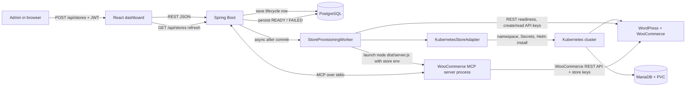
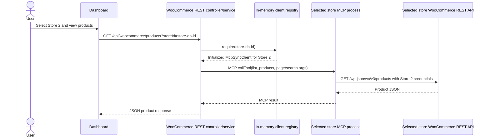
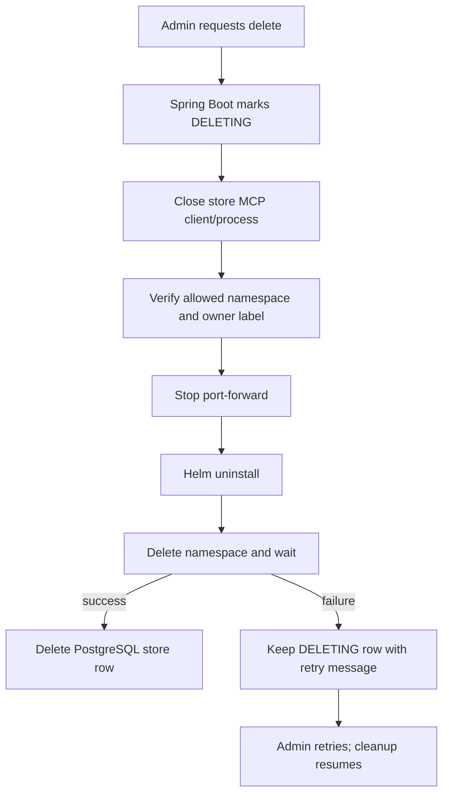

# Multi-store provisioning: request, Kubernetes, and MCP flow

This document focuses on what happens when an administrator creates an additional store, how that store becomes available through MCP, and how later data requests reach the correct store. It describes the current implementation in this repository.

## The key distinction

Creating a store creates an **e-commerce application deployment** in Kubernetes. It does not create a new MCP server deployment inside Kubernetes, and the WordPress store is not an MCP client or MCP server.

After Kubernetes has deployed WordPress/WooCommerce and MariaDB, Spring Boot starts the existing TypeScript WooCommerce MCP server program as a separate local child process and connects to that process as its MCP client. That process is configured with the new store's URL and API credentials. Thus:

- Spring Boot is the **MCP client** for the store-specific connection.
- `mcp-servers/woocommerce/dist/server.js` runs as the **MCP server** for that connection.
- WordPress/WooCommerce is the **upstream REST API** called by the TypeScript server.
- Each store gets its own server process and its own `McpSyncClient` entry in Spring Boot's in-memory registry. The server code is shared; the process configuration and connection are per store.

The per-store MCP server process currently runs alongside Spring Boot (inside the backend container in Docker Compose), not as a Kubernetes pod. Kubernetes hosts the store's WordPress and database workloads.

## End-to-end architecture



## Create-store lifecycle

```mermaid
sequenceDiagram
  actor Admin
  participant UI as React dashboard
  participant Controller as StoreProvisioningController
  participant Service as StoreProvisioningService
  participant DB as PostgreSQL
  participant Worker as StoreProvisioningWorker
  participant Adapter as KubernetesStoreAdapter
  participant K8s as Kubernetes / Helm
  participant Store as WordPress + WooCommerce
  participant Registry as WooCommerceMcpClientRegistry
  participant MCP as TypeScript MCP child process

  Admin->>UI: Submit store name
  UI->>Controller: POST /api/stores with bearer JWT
  Controller->>Service: createStore(request)
  Service->>Service: Check ADMIN, capacity, and next namespace
  Service->>DB: Save store as PROVISIONING
  Service-->>Controller: Store response
  Controller-->>UI: 201 response (PROVISIONING)
  Service->>Worker: Schedule after transaction commit
  Worker->>Adapter: provision(namespace, release, storeId, ports, secrets)
  Adapter->>K8s: Create owned namespace and Kubernetes Secrets
  Adapter->>K8s: Helm install/upgrade with --wait
  K8s-->>Adapter: Workloads ready
  Adapter->>K8s: Wait for ready pods; check WordPress service
  Worker->>Adapter: verify endpoint and ensure API credentials
  Adapter->>Store: Probe through local port-forward
  Adapter->>Store: Set up/read WooCommerce REST API credentials
  Adapter-->>Worker: URL, consumer key, consumer secret
  Worker->>Registry: register(store, URL, key, secret)
  Registry->>MCP: Start Node process with store-specific environment
  Registry->>MCP: Initialize MCP and list tools
  MCP-->>Registry: Advertise required WooCommerce tools
  Registry->>MCP: callTool(list_products) health check
  MCP->>Store: GET WooCommerce products REST endpoint
  Store-->>MCP: Successful response
  MCP-->>Registry: Successful MCP result
  Registry-->>Worker: Registered client for this store ID
  Worker->>DB: Persist URL and READY
```

### Step by step

1. **The dashboard sends a REST request.** `ManagedStoresPanel.tsx` calls `storesApi.create` in `dashboard/src/api.ts`. The helper posts `{ name }` to `/api/stores` and includes the logged-in user's bearer JWT. The dashboard is not sending an MCP message or talking to Kubernetes.
2. **Spring Boot accepts and records the operation.** `StoreProvisioningController` receives the request. Security requires an admin for `/api/stores/**`. `StoreProvisioningService.createStore` counts the existing store toward the three-store maximum, reserves the next free namespace/release (`ecommerce-store-2` or `ecommerce-store-3`), and inserts a `Store` row with status `PROVISIONING`.
3. **The HTTP call returns before provisioning finishes.** The worker is scheduled after the database transaction commits. The dashboard initially receives the lifecycle record, usually still in `PROVISIONING`; it later refreshes the list/status to see the outcome.
4. **The worker asks the Kubernetes adapter to provision.** `StoreProvisioningWorker` generates random WordPress and database passwords. `KubernetesStoreAdapter` checks the configured cluster context and namespace ownership, creates the namespace and labeled Kubernetes Secrets, and invokes the Helm chart from `helm/store-template` with a temporary values file.
5. **Kubernetes creates the store resources.** Helm creates WordPress/WooCommerce and MariaDB resources in the store namespace, including the database and persistence resources, quota/limits, and services/pods. The adapter waits for Helm and the store pods to become ready and confirms the WordPress Service exists. This is where Kubernetes resources are created; it does not yet mean the MCP connection has been registered.
6. **The backend reaches the new store.** The adapter starts or uses the store's local port-forward (ports 38082/38083), verifies the HTTP endpoint, and ensures WooCommerce REST API credentials exist. The resulting URL and consumer key/secret are passed in memory to the worker and then to the MCP registry. They are not sent to the browser.
7. **Spring Boot starts the store-specific MCP server process.** `WooCommerceMcpClientRegistry.register` starts Node with `mcp-servers/woocommerce/dist/server.js` and passes store-specific environment variables. Java builds a `StdioClientTransport` and an `McpSyncClient`; the child process is the MCP server and Java is its client.
8. **The connection is proven before READY.** Java initializes the MCP session, lists the server's advertised tools, checks that all expected tools exist, and invokes `list_products` with a small result size. The MCP tool handler calls the new store's WooCommerce REST API. If those checks succeed, the worker saves the URL and marks the database row `READY`. If any step fails, it records `FAILED` with a sanitized diagnostic.

## What “store is connected” means

There are three separate things that can be confused as one connection:

| Connection or resource | What it is | Created/owned by |
|---|---|---|
| Dashboard → Spring Boot | HTTP REST connection with a bearer token | Browser/dashboard |
| Spring Boot → TypeScript MCP process | MCP client/server session over stdio | Backend starts and owns the client and child process |
| TypeScript MCP process → WordPress/WooCommerce | HTTP REST calls authenticated with that store's API credentials | MCP server code and WooCommerce API |
| Kubernetes resources | WordPress, MariaDB, services, pods, PVCs, secrets, policies, namespace | Cluster, instructed by Helm/kubectl through backend adapter |

The connection to a particular store is not represented by a unique TypeScript codebase or a standalone MCP deployment. It is a separate process/session using the shared TypeScript server implementation plus that store's environment. PostgreSQL stores the durable store record and its lifecycle state; the live MCP sessions themselves live in the backend registry's memory.

## TypeScript WooCommerce MCP server

The WooCommerce server is implemented in `mcp-servers/woocommerce/src/` and compiled to `dist/` by the package's `npm run build` (`tsc`). Its runtime uses the official MCP TypeScript SDK and Zod schemas.

### Process startup and tool registration

`src/server.ts`:

1. Creates `McpServer` with the name `woocommerce-mcp-server`.
2. Imports each tool definition from `src/tools/`.
3. Uses `registerTool` to register tool names, descriptions, Zod input schemas, and async execute functions.
4. Catches tool failures and returns an MCP result with `isError: true` and a text message.
5. Connects the server using `StdioServerTransport`.

Stdio means the Java process and Node process exchange MCP protocol messages using the child process's standard input and output. Diagnostics go to stderr so ordinary logs cannot corrupt the protocol stream.

The advertised tools are:

| MCP tool | TypeScript handler | Purpose |
|---|---|---|
| `list_products` | `tools/list-products.ts` | List products with page, page size, and optional search |
| `get_product` | `tools/get_product.ts` | Read one product |
| `list_orders` | `tools/list-orders.ts` | List orders with pagination and optional status |
| `get_order` | `tools/get-order.ts` | Read one order |
| `list_customers` | `tools/list_customers.ts` | List customers with pagination |
| `get_customer` | `tools/get_customer.ts` | Read one customer |
| `create_product` | `tools/create-product.ts` | Create a WooCommerce product |
| `update_order_status` | `tools/update-order-status.ts` | Change an order status |

Each tool module defines the input schema and an execution function that delegates to `woocommerce-client.ts`. `config.ts` loads the process environment and requires `WOOCOMMERCE_URL`, `WOOCOMMERCE_CONSUMER_KEY`, and `WOOCOMMERCE_CONSUMER_SECRET`. Since the backend starts a separate process for each store, these values are specific to that process.

### WooCommerce REST client

`src/woocommerce-client.ts` builds the API base path `<store URL>/wp-json/wc/v3` and wraps the HTTP requests for products, orders, and customers. For local HTTP URLs, it signs WooCommerce requests with OAuth 1.0a parameters. For HTTPS URLs, it uses HTTP Basic authentication with the consumer key and secret. The MCP server translates the protocol tool arguments to REST endpoint paths, query values, and request bodies; it returns the REST response as MCP content.

### Simplified TypeScript shape

The following is representative pseudocode, not a replacement for the implementation:

```ts
const server = new McpServer({ name: "woocommerce-mcp-server", version: "1.0.0" });
server.registerTool("list_products", { inputSchema: { /* Zod schema */ } }, async (input) => {
  const result = await woocommerceClient.listProducts(input);
  return { content: [{ type: "text", text: JSON.stringify(result) }] };
});
await server.connect(new StdioServerTransport());
```

The store URL and keys are deliberately provided at process startup via environment rather than as tool arguments. A caller cannot select a different store by passing arbitrary credentials to `list_products`; Spring Boot chooses the correct store-specific MCP client first.

## Later request: get products, orders, or customers

The user selects a store in the dashboard. The dashboard includes the store's database ID as `storeId` in WooCommerce REST request parameters. Spring Boot then routes to the matching client in `WooCommerceMcpClientRegistry`.



The routing code is keyed by the persisted store ID, not the user-facing name or namespace. The registry's `require(storeId)` rejects missing/uninitialized sessions. `WooCommerceMcpService.invoke(storeId, ...)` calls the selected session and converts the MCP result into the REST response. Omitting `storeId` uses the default configured WooCommerce client for the existing store; it does not randomly select an additional store.

## Delete flow and what gets removed

Deleting a managed store closes its in-memory MCP client first. The backend then validates the namespace/release and ownership label, stops the matching port-forward, uninstalls the Helm release, and deletes the namespace. Only after Kubernetes cleanup succeeds does the backend remove the store row from PostgreSQL. If cleanup fails, the row remains `DELETING` with a retryable error so a later retry can continue. Store 1's existing `ecommerce` namespace is explicitly protected.



The database record and the live MCP client are different types of state. Deleting the record alone would not stop the MCP process or remove Kubernetes resources; the delete worker performs cleanup in a controlled order.

## Restart recovery

The `McpSyncClient` registry and Node child processes are in-memory runtime state. A backend restart clears them. On startup, `StoreReconciliationRunner` scans persisted stores:

- `PROVISIONING`: resume provisioning.
- `DELETING`: resume deletion.
- `READY`: re-check the store endpoint, API credentials, and required MCP connection; rebuild the in-memory client.

If a formerly ready store cannot pass validation, its client is unregistered and its status becomes `FAILED`. This is why a durable `READY` row does not by itself prove a live MCP process exists after a backend restart; readiness is re-established during reconciliation.

## Relevant implementation files

- Dashboard request and store selection: `dashboard/src/api.ts`, `dashboard/src/ManagedStoresPanel.tsx`, `dashboard/src/App.tsx`.
- REST route: `backend/src/main/java/com/mcp_gateway_k8s_store/backend/controller/StoreProvisioningController.java`.
- Capacity, naming, state transition, retry, deletion request: `backend/src/main/java/com/mcp_gateway_k8s_store/backend/service/StoreProvisioningService.java`.
- Async create/delete and status persistence: `backend/src/main/java/com/mcp_gateway_k8s_store/backend/service/StoreProvisioningWorker.java`.
- Kubernetes and Helm operations, endpoint, credentials, port-forward: `backend/src/main/java/com/mcp_gateway_k8s_store/backend/service/KubernetesStoreAdapter.java`.
- Per-store MCP process and client registry: `backend/src/main/java/com/mcp_gateway_k8s_store/backend/service/WooCommerceMcpClientRegistry.java`.
- MCP-to-REST tool routing: `backend/src/main/java/com/mcp_gateway_k8s_store/backend/service/WooCommerceMcpService.java`.
- TypeScript server entry point and MCP transport: `mcp-servers/woocommerce/src/server.ts`.
- TypeScript settings and REST wrapper: `mcp-servers/woocommerce/src/config.ts`, `mcp-servers/woocommerce/src/woocommerce-client.ts`.
- Tool schemas and handlers: `mcp-servers/woocommerce/src/tools/`.
- Kubernetes chart: `helm/store-template/`.
